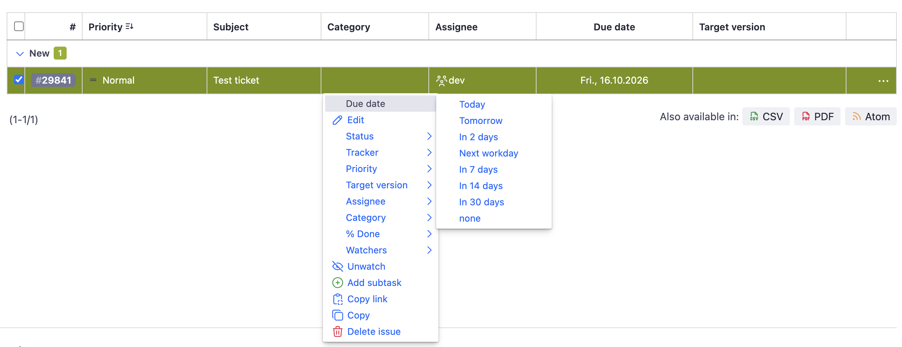

# Redmine Context Menu Dates

A small [Redmine](https://www.redmine.org/) plugin that lets you change the start date and due date of issues directly via the context menu (right-click) in the issue list.

## Introduction

Redmine offers almost everything we need out of the box. We only had to extend it a little for our internal needs, and this plugin was the result.

## Example


## Features

The context menu of the issue list gets two new submenus, **Start date** and **Due date**, with these options:

| Option    | Sets the date to                                        |
|-----------|---------------------------------------------------------|
| Today     | today                                                   |
| Tomorrow  | today + 1 day                                           |
| In 2 days | today + 2 days                                          |
| Next week | the next first day of the week (e.g. the next Monday)   |
| In 7 days | today + 7 days                                          |
| In 14 days| today + 14 days                                         |
| In 30 days| today + 30 days                                         |
| none      | removes the date                                        |

- **Next week** uses the *Start calendars on* setting in **Administration → Settings → Display**. If it is not set, the first day of the week of the user's language is used.
- When the **start date** is changed and the issue also has a due date, the due date is moved along so the duration of the issue stays the same.
- The submenus only appear if the user is allowed to edit the respective field.
- The menu entries are available in English and German.

## Installation

1. Clone the plugin into the `plugins` directory of your Redmine installation. The directory name must be `redmine_context_menu_dates`, as it has to match the plugin ID:

   ```bash
   cd /path/to/redmine/plugins
   git clone https://github.com/ablida/redmine_context_menu_dates.git
   ```

   Alternatively, download the repository as a ZIP and extract it to `plugins/redmine_context_menu_dates`.

2. Restart Redmine.

No database migrations are required. More information on installing Redmine plugins: [Redmine Plugins](https://www.redmine.org/projects/redmine/wiki/Plugins).

## Usage

No configuration is needed. Right-click one or more issues in the issue list and choose a date from the **Start date** or **Due date** submenu.

## Uninstallation

Remove the `plugins/redmine_context_menu_dates` directory and restart Redmine.

## License

This plugin is licensed under the [GNU General Public License v2.0](LICENSE), unless otherwise stated.

## About

Copyright (c) 2026 ablida
